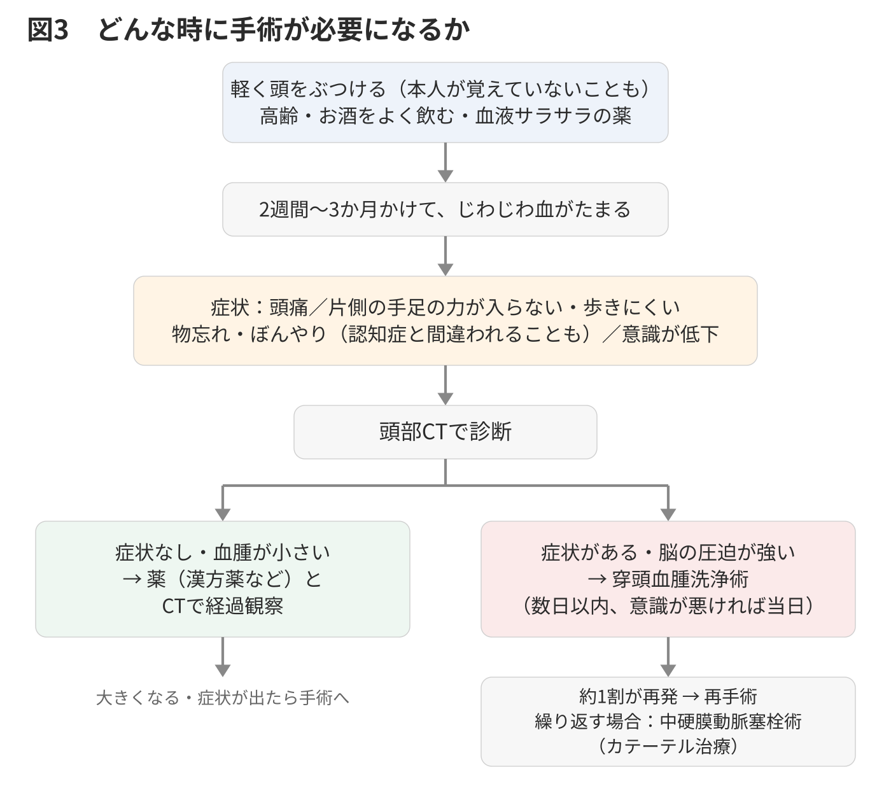
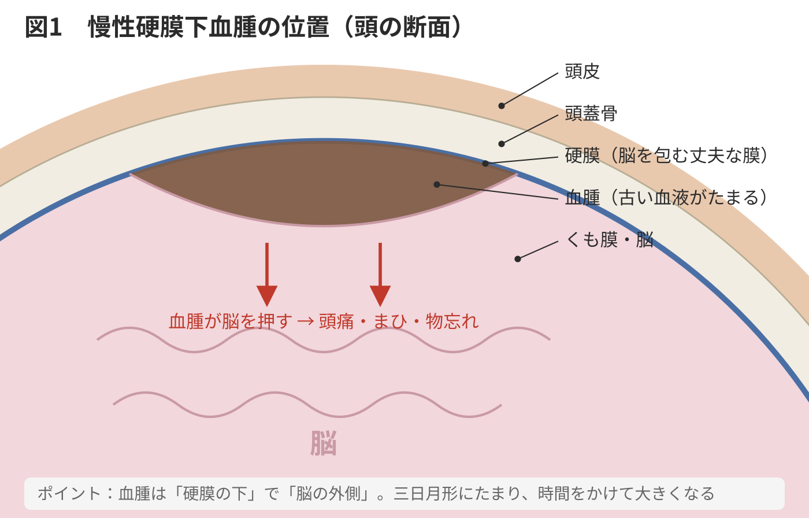
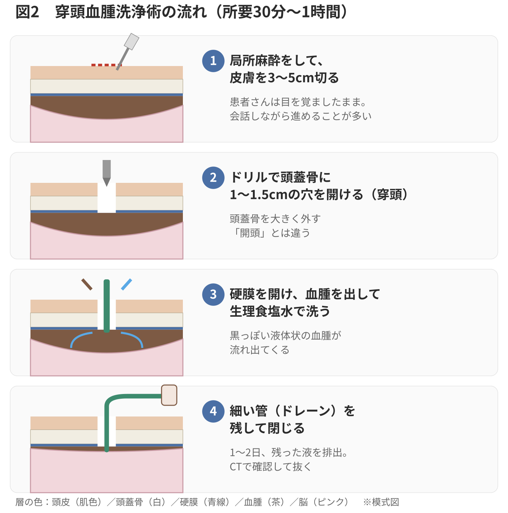

# 第1回 慢性硬膜下血腫の穿頭血腫洗浄術

読み方：まんせいこうまくかけっしゅ の せんとうけっしゅせんじょうじゅつ

## ひとことで言うと

頭蓋骨に1〜1.5cmの小さな穴を開け、脳の表面にじわじわたまった血液を外に出して洗い流す手術です。多くは局所麻酔で、患者さんと会話しながら30分〜1時間ほどで終わります。脳外科医が研修の早い時期に担当することの多い、代表的な手術です。

## どんな時に必要になるか

**病気の成り立ち**

- 軽く頭をぶつけたあと、2週間〜3か月かけて、硬膜の下にゆっくり血がたまる
- 本人が打ったことを覚えていないことも多い
- なりやすい人：高齢者、お酒をよく飲む人、抗凝固薬・抗血小板薬を飲んでいる人

**手術を決める基準**

- 症状がある（頭痛、片側の手足の力が入りにくい、歩きにくい、物忘れ・ぼんやり、意識低下）
- または、CTで脳が強く押されている

**急ぐ度合い**

- 多くは準緊急で、診断から当日〜数日以内
- 意識が悪い場合は当日の緊急手術

**手術しない場合**

- 症状がなく血腫が小さければ、漢方薬などとCTでの経過観察
- 大きくなる・症状が出れば手術へ。放置して大きくなると命に関わることがある

**手術に至る典型的な流れ**

- 「最近急に物忘れが増えた」「歩き方がおかしい」で家族が内科・かかりつけ医・救急を受診 → 頭部CTで発見 → 脳神経外科へ紹介
- 認知症外来や、転倒で受診した整形外科で見つかることも
- 手術で症状がよくなることがあるため「治る可能性のある認知症」の一つとして紹介されることがある

## 関係する解剖

- 外側から「頭皮 → 頭蓋骨 → 硬膜 → くも膜 → 脳」
- 血腫は硬膜とくも膜のあいだに三日月形にたまる
- 血腫は液体状で、薄い膜（被膜）に包まれている。被膜のもろい血管から出血を繰り返し、血を溶かす反応（線溶）も起きるため、固まらずに少しずつ増える

## 麻酔と体位

- 局所麻酔が多い。落ち着いていられない場合は鎮静または全身麻酔
- あお向け（仰臥位）で、顔を手術と反対側に向ける

## 手術の流れ

1. 剃毛・消毒・局所麻酔をして、皮膚を3〜5cm切開
2. ドリルで頭蓋骨に1〜1.5cmの穴を開ける（穿頭）
3. 硬膜と被膜を開くと黒っぽい液体状の血腫が流れ出る。生理食塩水で洗う
4. ドレーンを残して閉創。1〜2日排液し、CTで確認して抜去

## 所要時間・入院期間

- 手術：30分〜1時間
- 入院：1週間前後（病院のクリニカルパスでは6〜8日程度が多い）

## 術後の入院生活

- ドレーンが入っている1〜2日はベッド上安静。排液バッグは医師が指示した高さに固定
- 頭を高く上げずに平らに寝るよう指示する病院もある（脳がふくらんで空間がふさがりやすいように）
- トイレは尿道カテーテルかベッド上
- ドレーン抜去後、看護師の付き添いでトイレ歩行から開始。リハビリも始まり、転倒予防が大きなテーマ

## 合併症と副作用

**術中**

- 脳表からの出血、脳損傷（まれ）

**術後早期（〜数日）**

- 急性の出血（急性硬膜外血腫など）：まれだが再手術が必要になることがある
- 気脳症（空気がたまって脳を押す）
- けいれん、創部や頭蓋内の感染、ドレーンの事故抜去・閉塞
- 高齢者ではせん妄、転倒

**退院後（晩期）**

- 再発：約1割（報告により1〜2割）。抗血栓薬内服、両側性などが危険因子
- 繰り返す場合はカテーテル治療の中硬膜動脈塞栓術が有効と報告されている
- 手術で洗浄を省くと6か月以内の再手術率が6.0ポイント高かった海外の試験がある（FINISH試験、Lancet 2024）

**薬・麻酔**

- 局所麻酔薬のアレルギー・中毒（まれ）
- 抗血栓薬の中止期間中の脳梗塞・心筋梗塞リスク（中止・再開は処方元と相談）
- 抗けいれん薬の眠気・ふらつき

**医師の説明と看護の観察**

- 医師：「比較的短時間で負担の少ない手術ですが、1割ほど再発があります」
- 看護：意識レベル（JCS・GCS）、瞳孔、麻痺、けいれん、ドレーン排液の量と色、事故抜去の予防、転倒、せん妄

## 素朴な疑問Q&A

**Q. 血腫は古い血液なの？**
A. 古い血と、被膜のもろい血管から少しずつ出る新しい血が混ざった、固まらない液体です。見た目は赤黒〜茶色のサラサラした液体で、「エンジンオイルのよう」と表現されます。急性硬膜下血腫はゼリー状の固まりなので、穴からは出せず開頭手術になります。

**Q. 術後はドレーンをつけたまま動けるの？**
A. 1〜2日はベッド上安静です。抜いたあとに付き添いつきで歩き始めます。「管をつけたまま歩き回る」描写は不正確です。

**Q. ドレーンは何でできているの？**
A. 主に柔らかいシリコーン製で、先端に側孔があり、X線に写るラインが入っています。

## 説明と同意のポイント

- **医師**：手術同意書（再発・出血・感染）、抗血栓薬の扱い。判断力が落ちていれば家族へ説明・同意
- **看護師**：剃毛、ドレーン中の安静、転倒予防
- **診療放射線技師**：術前後のCT
- **医事課**：急な入院の費用の目安、高額療養費制度

## 診療報酬

| 区分 | 名称 | 点数 |
| --- | --- | --- |
| K164-2 | 慢性硬膜下血腫穿孔洗浄術 | 10,900点（令和6年版で確認。令和8年版は要確認） |

- 令和8年版の通知でも、穿頭による慢性硬膜下血腫洗浄・除去術はK164-2で算定する（K147穿頭術ではない）

## 現場で使われる言葉

- **CSDH**（シーエスディーエイチ）：慢性硬膜下血腫
- **穿頭**（せんとう）／**バーホール**：頭蓋骨に開ける小さな穴
- **ドレーン**：排液用の管
- **JCS・GCS**：意識レベルの指標
- **MMA塞栓**：中硬膜動脈塞栓術

## 動画制作で役立つ視点

- 「頭蓋骨を大きく開ける」手術ではない。小さな穴で、患者は起きたまま受けることが多い
- 急性硬膜下血腫とは別の病気。混同しない
- 血腫は「硬膜の下」。図解でよく間違われる
- 「認知症が治る」と言い切らず「改善することがある」に

## 参考動画

- [富山労災病院 脳神経外科「高齢者に多い慢性硬膜下血腫」](https://www.youtube.com/watch?v=RZJDLIDcgIQ)（病院公式・一般向け）
- [諏訪赤十字病院「日赤健康チャンネル」慢性硬膜下血腫について](https://www.youtube.com/watch?v=JuvyL2gNNBs)
- [慢性硬膜下血腫穿頭洗浄術](https://www.youtube.com/watch?v=HlJPH-HvI9M)（脳外科医の個人発信。手術映像あり）

## 確認クイズ

1. 慢性硬膜下血腫がたまるのは硬膜の「上」と「下」のどちら？
2. この手術でよく使われる麻酔は？
3. 再発はおよそ何割？

答え：① 下　② 局所麻酔　③ 約1割（報告によっては1〜2割）

## 出典

- [慢性硬膜下血腫の治療ポイント（日本医事新報）](https://www.jmedj.co.jp/blogs/product/product_751)
- [慢性硬膜下血腫［私の治療］（日本医事新報）](https://www.jmedj.co.jp/blogs/product/product_23694?page=2)
- [慢性硬膜下血腫の穿頭ドレナージ術、洗浄なしvs.あり（ケアネット）](https://www.carenet.com/news/journal/carenet/58830)
- [K164-2 慢性硬膜下血腫穿孔洗浄術（今日の臨床サポート）](https://clinicalsup.jp/jpoc/shinryou.aspx?file=ika_2_10_1_3_1/k164-2.html)
- [慢性硬膜下血腫穿頭・洗浄術パス（札幌市立病院）](https://www.city.sapporo.jp/hospital/hospitalization/clinical_pathways/documents/24005-01-20260319.pdf)
- [慢性硬膜下血腫の手術を受けられる方へ（日本赤十字社医療センター）](https://www.med.jrc.or.jp/Portals/0/resources/byoinjoho/data_R06/pass/150-1%20慢性硬膜下血腫の手術.pdf)
