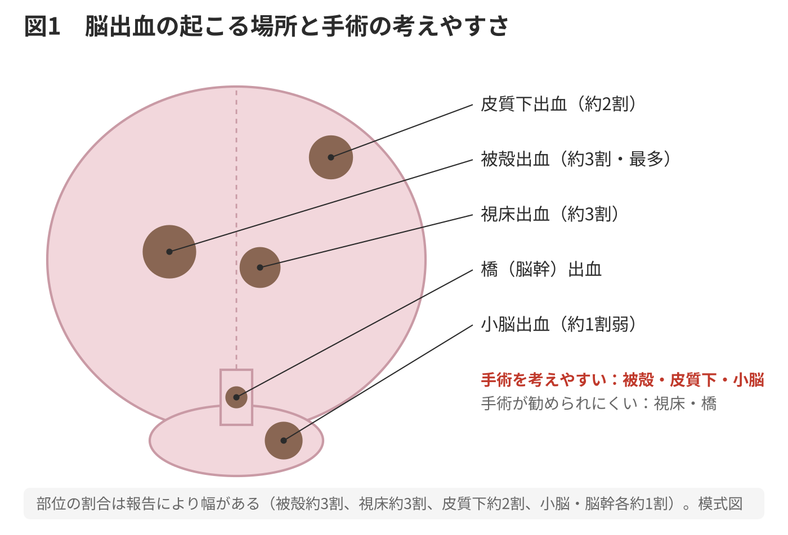
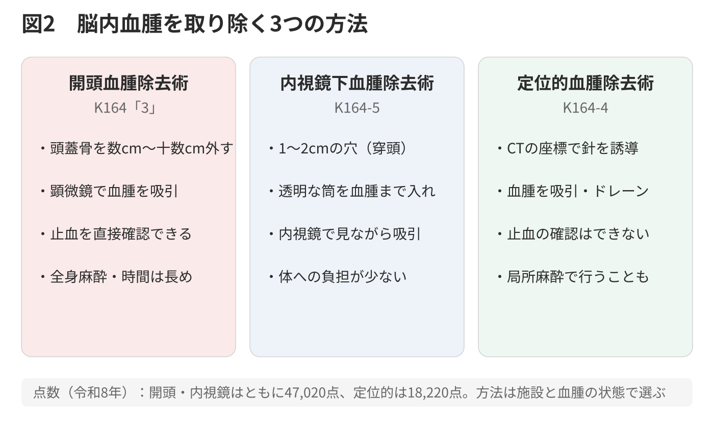

# 第2回 開頭血腫除去術（脳出血）

読み方：かいとうけっしゅじょきょじゅつ

> この回は、元の配信チャットが読めないため2026-11-20に作り直した版です。

## ひとことで言うと

脳の中の血管が破れてできた血のかたまり（脳内血腫）を、頭蓋骨を一部外して取り除く手術です。目的は、血腫が脳を押しつぶす力を減らして命を守ること、後遺症を少しでも軽くすることです。脳出血の多くは手術ではなく薬（降圧など）で治療し、手術になるのは一部です。

## どんな時に必要になるか

**病気の成り立ち**

- 脳出血は脳卒中のうち約2割。多くは高血圧で傷んだ細い動脈が破れて起こる
- 若い人の皮質下出血では脳動静脈奇形（AVM）、高齢者ではアミロイドアンギオパチー（血管にたまる異常たんぱく）が原因のこともある
- 抗凝固薬・抗血小板薬の内服中は出血が大きくなりやすい

**手術を考える目安**（脳卒中治療ガイドライン2021の考え方に基づく。最終判断は施設と患者の状態による）

- **被殻出血**：血腫量31mL以上で、圧迫所見と神経症状が中等度以上
- **小脳出血**：最大径3cm以上で神経症状が悪化している、または脳幹圧迫や水頭症がある
- **皮質下出血**：脳表から1cm以内の浅い血腫など
- 手術が勧められにくい：視床出血・脳幹（橋）出血（深い場所にあり、手術で脳を傷つける割合が大きい）。ただし水頭症があれば脳室ドレナージ（第3回）を行う
- 血腫が小さい・症状が軽い場合、深昏睡で回復の見込みが乏しい場合は手術しないことが多い

**急ぐ度合い**

- 緊急〜準緊急。来院当日〜数日以内
- まず血圧を下げ、抗血栓薬の効果を打ち消す薬（拮抗薬）を使い、血腫の拡大を防ぐ

**手術以外の選択肢**

- 降圧、脳のむくみを抑える治療、リハビリ（多くの患者はこちら）
- より負担の少ない手術：内視鏡下血腫除去術、定位的血腫除去術（図2）

**手術に至る典型的な流れ**

突然の片麻痺・ろれつが回らない・意識障害 → 救急搬送（脳卒中を疑う「Time is brain」）→ 頭部CTで白く写る出血を確認 → 脳神経外科・脳神経内科（脳卒中チーム）で治療方針を決定

## 関係する解剖

- 外側から頭皮 → 頭蓋骨 → 硬膜 → くも膜 → 脳。脳内血腫は「脳そのものの中」にできる（第1回の慢性硬膜下血腫は脳の外側）
- 被殻・視床は脳の深い場所。そばを手足を動かす神経の束（内包）が通るため、出血で反対側の手足が麻痺する
- 小脳の出血は、すぐ前の脳幹（呼吸や意識の中枢）と、髄液の通り道（第4脳室）を圧迫しやすい

## 麻酔と体位

- 全身麻酔
- 被殻・皮質下：あお向けで頭を横向き。小脳：うつ伏せ（腹臥位）や横向き
- 頭はピン固定器で動かないように固定

## 手術の流れ

1. 剃毛・消毒、皮膚を弧状に切開
2. 頭蓋骨を一部外す（開頭）
3. 硬膜を開き、脳の表面を小さく切って（またはすき間から）血腫に到達
4. 顕微鏡で見ながら血腫を吸引し、出血している血管を電気で焼いて止血
5. 硬膜を縫い、骨を戻してプレートで固定、皮膚を縫う
6. 脳が強く腫れている場合は骨を戻さない（外減圧、第19回）

## 所要時間・入院期間

- 手術：2〜4時間程度
- 入院：急性期病院で数週間。その後、回復期リハビリテーション病院へ転院することが多い

## 術後の入院生活

- 当日はICU・SCU（脳卒中ケアユニット）で、意識・瞳孔・麻痺・血圧を頻回にチェック
- 頭に皮下ドレーンが入ることが多く、1〜2日で抜く
- 翌日CTで再出血がないか確認
- 早期からリハビリ（ベッド上→座る→立つ）。食事は飲み込み（嚥下）の評価をしてから

## 合併症と副作用

**術中**

- 出血が止まりにくい、脳の腫れ

**術後早期**

- **再出血**：最も重要な合併症。頻度は施設や報告により異なる（1割前後との報告もある）。意識低下・麻痺の悪化で気づき、CTで確認、再手術のことも
- 脳の腫れ（浮腫）、けいれん、感染（創部・髄膜炎）
- 肺炎（特に誤嚥性）、深部静脈血栓症、消化管出血
- 降圧薬の使いすぎによる低血圧

**晩期**

- 麻痺・言語障害などの後遺症（出血そのものによる。手術は命を守り悪化を防ぐのが主目的）
- 症候性てんかん、骨を外したままの場合は頭蓋形成術が必要（第20回）

**医師の説明でよくある言い方**

- 「手術は命を守るためと、これ以上の悪化を防ぐためで、すでに傷んだ脳の機能が元に戻るわけではありません」

**看護の観察**

- 意識（JCS・GCS）、瞳孔、麻痺の左右差、血圧（指示範囲内か）、けいれん、ドレーン排液

## 素朴な疑問Q&A

**Q. 脳出血と脳梗塞はどう違う？**
A. 脳出血は血管が「破れる」、脳梗塞は血管が「詰まる」病気です。CTでは出血は白く、梗塞は時間がたつと黒く写ります。治療は正反対で、梗塞では血をサラサラにし、出血では止める方向にします。

**Q. 外した頭蓋骨はどうなるの？**
A. 多くは手術の最後に戻し、小さなチタンプレートとネジで固定します。脳の腫れが強いときは戻さずに冷凍保存などをして、数週間〜数か月後に戻します（頭蓋形成術）。

**Q. 血を取れば麻痺は治る？**
A. 出血で壊れた脳の部分は元に戻りません。手術は圧迫による悪化を防ぐもので、回復はリハビリが中心です。

## 説明と同意のポイント

- **医師**：手術の目的（救命・悪化防止）と限界、再出血・感染・けいれん、後遺症の見通し。意識障害のため家族への説明・同意が中心。輸血の同意
- **看護師**：ICUでの面会、家族の待機、術後の観察とリハビリの流れ
- **診療放射線技師**：術前後のCT、必要に応じCTA（造影CTで血管を見る）
- **医事課**：緊急入院、高額療養費、長期入院と転院の見通し、身体障害者手帳など制度の案内はMSW（医療ソーシャルワーカー）と連携

## 診療報酬（令和8年）

| 区分 | 名称 | 点数 |
| --- | --- | --- |
| K164「3」 | 頭蓋内血腫除去術（開頭して行うもの）脳内のもの | 47,020点 |
| K164-5 | 内視鏡下脳内血腫除去術 | 47,020点 |
| K164-4 | 定位的脳内血腫除去術 | 18,220点 |

- 区分番号の書き方に注意：「K164の『3』」（枝番）と「K164-3」（脳血管塞栓（血栓）摘出術という別の手術）は別物
- 参考：K164「1」硬膜外のもの 35,790点、「2」硬膜下のもの 36,970点

## 現場で使われる言葉

- **ICH**（アイシーエイチ）：脳内出血 intracerebral hemorrhage
- **SCU**：脳卒中ケアユニット
- **開頭（かいとう）**：頭蓋骨を外すこと／**閉頭**：戻すこと
- **ミッドラインシフト**：脳の中心線のずれ。圧迫の強さの目安
- **JCS・GCS**：意識レベル

## 動画制作で役立つ視点

- 「脳出血＝すぐ手術」ではない。多くは薬とリハビリで、手術は一部
- 手術の目的は「救命と悪化防止」。「手術で麻痺が治る」と描かない
- 脳梗塞と脳出血を混同しない（治療が正反対）
- 部位で症状と治療が違う（被殻・視床・皮質下・小脳・脳幹）

## 参考動画

元の回の動画リンクは確認できなかったため、今回は掲載していません。次の更新で追加します。

## 確認クイズ

1. 手術が勧められにくいのはどの部位の出血？（被殻／視床／小脳）
2. 小脳出血で手術を考える大きさの目安は？
3. 「K164-3」は脳内血腫の開頭手術の区分番号として正しい？

答え：① 視床　② 最大径3cm以上（神経症状の悪化・脳幹圧迫・水頭症があるとき）　③ 誤り。正しくはK164の「3」（K164-3は別の手術）

## 出典

- [K164 頭蓋内血腫除去術（ナレティ、令和8年度）](https://knowlety.jp/ika/k164/)
- [K164-5 内視鏡下脳内血腫除去術（ナレティ、令和8年度）](https://knowlety.jp/ika/k164-5/)
- [K164-4 定位的脳内血腫除去術（今日の臨床サポート、令和8年版）](https://clinicalsup.jp/jpoc/shinryou.aspx?file=ika_2_10_1_3_1%2Fk164-4.html)
- [脳内出血［私の治療］（日本医事新報）](https://jmedj.co.jp/journal/paper/detail.php?id=22189)
- [脳内出血（MSDマニュアル プロフェッショナル版）](https://www.msdmanuals.com/ja-jp/professional/07-神経疾患/脳卒中/脳内出血)
- [内視鏡下血腫除去術の基本と応用（脳卒中の外科, J-STAGE）](https://www.jstage.jst.go.jp/article/scs/48/3/48_190/_article/-char/ja)
- [脳出血 救急部カンファレンス（松山赤十字病院）](https://www.matsuyama.jrc.or.jp/media/careers/PDF/resident/e/conference/2022/emergency%20conference%20R4_02.pdf)
