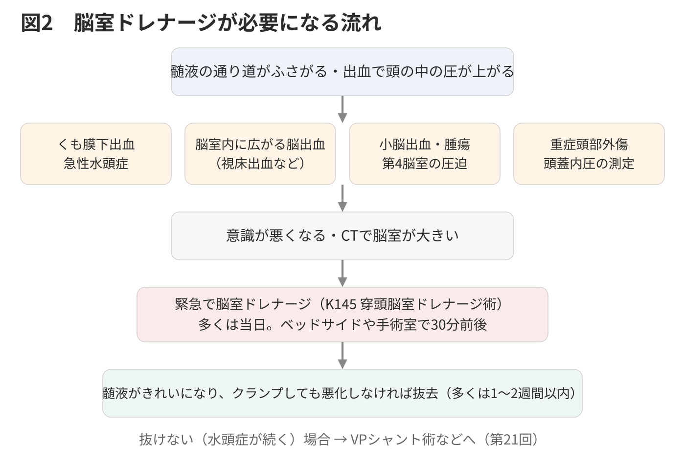
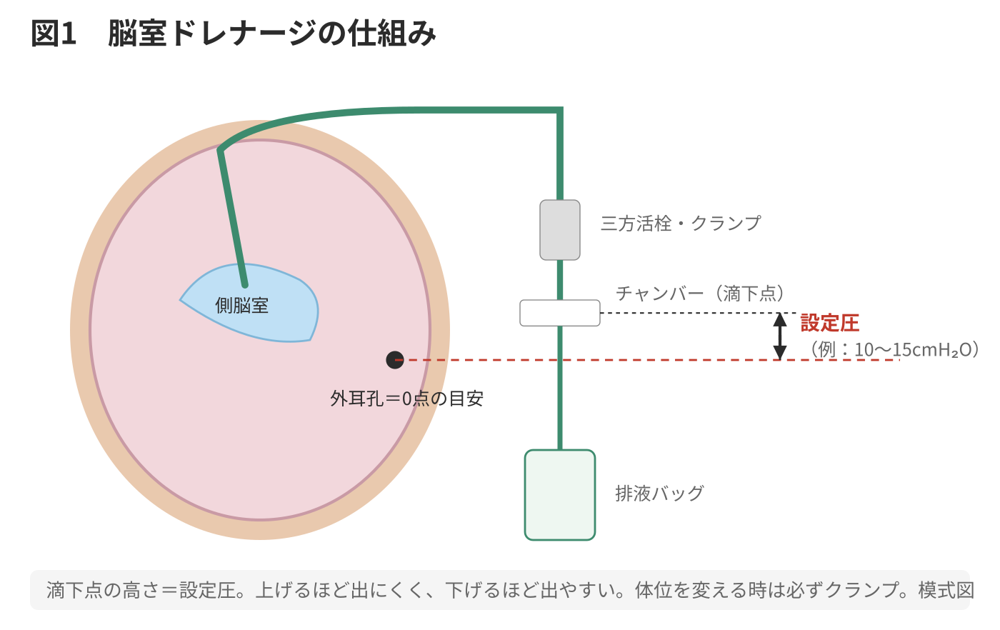

# 第3回 脳室ドレナージ

読み方：のうしつドレナージ

> この回は、元の配信チャットが読めないため2026-11-20に作り直した版です。

## ひとことで言うと

頭蓋骨に小さな穴を開け、脳の中の「脳室」という髄液のたまり場まで細い管を入れて、たまりすぎた髄液や血液を体の外へ逃がす処置です。頭の中の圧（頭蓋内圧）を下げて命を守る、脳外科の代表的な緊急処置です。

## どんな時に必要になるか

**病気の成り立ち**

- 脳室では1日に約500mLの髄液が作られ、決まった通り道を流れて吸収される
- 出血や腫瘍で通り道がふさがると、髄液がたまって脳室がふくらむ（急性水頭症）。頭の中の圧が上がり、意識が悪くなる

**必要になる主な場面**

- くも膜下出血（脳動脈瘤の破裂）に伴う急性水頭症
- 脳室内に広がる脳出血（視床出血など）
- 小脳出血・小脳の腫瘍で第4脳室が圧迫されるとき
- 重症頭部外傷で頭蓋内圧を測りながら管理するとき
- 脳の手術で、髄液を抜いて脳をしぼませ、操作しやすくするため

**急ぐ度合い**

- 緊急。意識低下とCTでの脳室拡大があれば当日すぐ

**手術以外の選択肢**

- 一時的な処置なので、原因の病気（動脈瘤、出血、腫瘍）の治療と組み合わせる
- 長く必要な場合はVPシャント（第21回）などの「体の中に埋め込む」方法へ切り替える

**手術に至る典型的な流れ**

くも膜下出血・脳出血で救急搬送 → CTで脳室拡大 → 脳神経外科医が判断 → ICU・救急・手術室で緊急に留置

## 関係する解剖

- 左右の大脳の中に「側脳室」があり、そこから第3脳室 → 中脳水道 → 第4脳室へと髄液が流れる
- 管は多くの場合、前頭部の決まった点（コッヘル点：髪の生え際の少し後ろ、正中から指2本分ほど外側）から側脳室の前の部分へ入れる

## 麻酔と体位

- 局所麻酔（意識障害がある患者が多い）。挿管されている患者では鎮静下
- あお向けで頭をやや上げる

## 手術の流れ

1. 剃毛・消毒、局所麻酔
2. 皮膚を小さく切り、ドリルで頭蓋骨に穴を開ける（穿頭）
3. 硬膜を小さく開け、脳室カテーテルを決まった方向・深さ（皮膚から約5〜6cm）で進める
4. 髄液が流れ出ることを確認。必要なら圧を測る
5. 管を皮膚の下に数cmくぐらせてから外に出し（感染予防）、固定
6. 外の回路（三方活栓・チャンバー・排液バッグ）につなぎ、医師が指示した高さに設定

所要時間：30分前後。ベッドサイドで行うことも、手術室で行うこともある

## 回路の管理（図1）

- **0点**：外耳孔（耳の穴）の高さを、脳室の高さの目安にする
- **設定圧**：0点からチャンバーの滴下点までの高さ（cmH₂O）。高くすると出にくく、低くすると出やすい
- **クランプ**：体位変換・移動・検査の前には必ず管を閉じる。開けたままベッドの高さを変えると、急に大量に抜けて危険（オーバードレナージ）
- 排液の量・色（血性→キサントクロミー（黄色）→透明）、管の中の液面が拍動に合わせて揺れるか（拍動）を観察

## 所要時間・入院期間

- 留置期間：多くは1〜2週間以内。感染のリスクが上がるため長く入れすぎない
- 入院期間は原因の病気（くも膜下出血など）で決まる。数週間〜1か月以上のことが多い

## 術後の入院生活

- ICUで管理。ドレーンが入っている間は安静度に制限がある（頭の高さを固定）
- 抜去前には「クランプテスト」（管を閉じて1〜2日様子を見る）。意識が悪くならず、CTで脳室が大きくならなければ抜去
- 抜去後、数日で歩行やリハビリが進む（原因の病気次第）

## 合併症と副作用

**留置時**

- 出血（管の通り道や脳室内）。抗血栓薬の内服や出血しやすい体質で注意
- 管の位置がずれる、髄液が出ない

**留置中**

- **感染（脳室炎・髄膜炎）**：最も重要。報告により幅があるが数%〜1割前後。発熱、髄液の濁り、意識の変化で気づく。予防策をまとめて行う「ケアバンドル」導入で、1,000カテーテル日あたり13.4件から2.5件に減ったという報告がある
- オーバードレナージ：髄液が抜けすぎて頭痛・意識低下、硬膜下血腫、くも膜下出血の場合は動脈瘤の再破裂のリスク
- アンダードレナージ・閉塞：血のかたまりで詰まり、頭蓋内圧が上がる
- 事故抜去（せん妄の患者が引き抜くなど）、髄液漏

**晩期**

- 水頭症が残り、シャント手術が必要になることがある

**医師の説明でよくある言い方**

- 「命を守るための緊急の処置です。管が入っている間は感染に最も注意します」

**看護の観察**

- 0点と設定圧の確認（勤務交代ごと・体位変換ごと）、クランプの開閉、排液量（1時間ごと）・性状、拍動、刺入部、体温、意識・瞳孔

## 素朴な疑問Q&A

**Q. 脳に管を刺して大丈夫なの？**
A. 管は脳のなかでも、傷ついても症状が出にくい場所（前頭葉の決まった部分）を通るように入れます。それでも出血などのリスクはゼロではないため、緊急で必要なときに行います。

**Q. 髄液を抜いて減らないの？**
A. 髄液は1日に約500mL作られ続けるので、抜いても作られます。抜く量は設定圧で調整します。

**Q. なぜ耳の穴が基準なの？**
A. 寝た姿勢では、外耳孔の高さが脳室の高さにほぼ一致するためです。

## 説明と同意のポイント

- **医師**：緊急性、出血・感染のリスク、留置期間、シャントが必要になる可能性。意識障害のため家族への説明が中心
- **看護師**：管が入っている間の安静、触らない・引っ張らないこと、家族の面会時の注意
- **診療放射線技師**：CTで管の位置と脳室の大きさを確認
- **医事課**：手術料は初回のみ。翌日以降のドレナージは処置料で日ごとに算定

## 診療報酬（令和8年）

| 区分 | 名称 | 点数 |
| --- | --- | --- |
| K145 | 穿頭脳室ドレナージ術 | 2,330点 |
| J002「1」 | ドレーン法 持続的吸引を行うもの（1日につき） | 50点 |
| J002「2」 | ドレーン法 その他のもの（1日につき） | 25点 |

- K145は初回に限り算定し、2回目以降のドレナージはJ002で算定する（通知）
- 穿頭術の手技料はK145に含まれ、別に算定できない

## 現場で使われる言葉

- **EVD**（イーブイディー）：脳室ドレナージ external ventricular drain
- **ベントリクル**：脳室（ventricle）
- **0点合わせ**：外耳孔に回路の基準を合わせること
- **クランプ**：管を閉じること／**開放**
- **オーバードレナージ**：抜けすぎ
- **キサントクロミー**：出血後に髄液が黄色くなること
- **ICP**（アイシーピー）：頭蓋内圧

## 動画制作で役立つ視点

- 「脳に管が入っている」場面は刺激が強い。模式図で回路の仕組み（0点・設定圧）を見せると伝わりやすい
- 回路は「高さ」で量を調整する、という点が独特で視覚化しやすい
- 体位変換前のクランプなど、看護の安全確認の場面は動画のテーマになりやすい

## 参考動画

元の回の動画リンクは確認できなかったため、今回は掲載していません。次の更新で追加します。

## 確認クイズ

1. 脳室ドレナージの0点の目安になるのは体のどこ？
2. 設定圧を上げると、髄液は出やすくなる？出にくくなる？
3. K145は留置期間中に毎日算定できる？

答え：① 外耳孔　② 出にくくなる　③ できない。初回のみK145、2回目以降はJ002ドレーン法

## 出典

- [K145 穿頭脳室ドレナージ術（今日の臨床サポート、令和8年版）](https://clinicalsup.jp/jpoc/shinryou.aspx?file=ika_2_10_1_3_1%2Fk145.html)
- [J002 ドレーン法（しろぼんねっと、令和8年）](https://shirobon.net/medicalfee/latest/ika/r08_ika/r08i_ch2/r08i2_pa9/r08i29_sec1/r08i291_cls1/r08i2911_J002.html)
- [脳室ドレナージ—頭蓋内の解剖・生理学を理解して適切な管理を行う（医学書院）](https://webview.isho.jp/journal/detail/abs/10.11477/mf.3102200293)
- [脳神経外科領域のドレナージ（看護roo!）](https://www.kango-roo.com/learning/3848/)
- [External ventriculostomy-associated infection reduction after updating a care bundle（PMC）](https://www.ncbi.nlm.nih.gov/pmc/articles/PMC10349458/)
