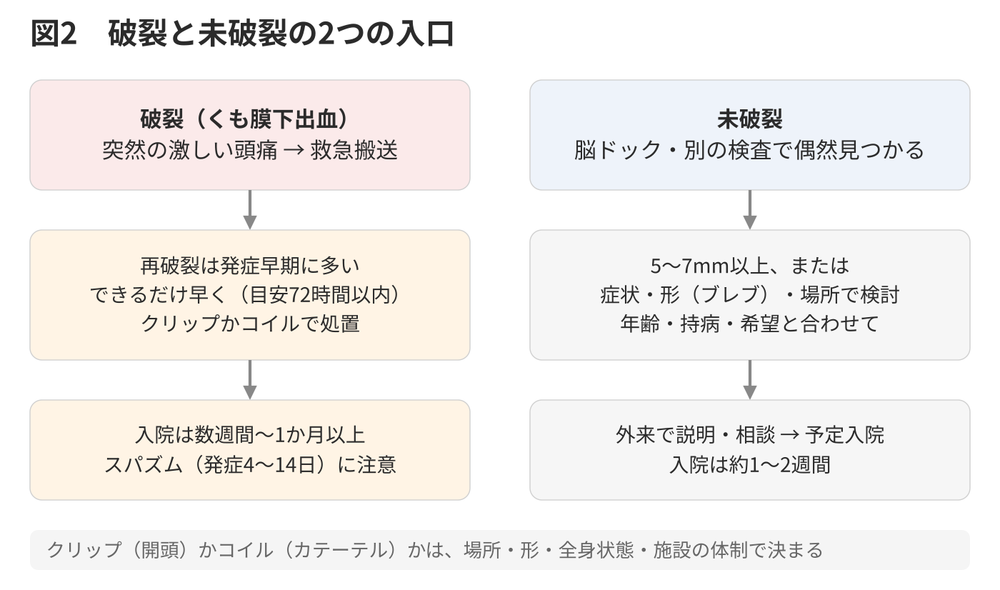
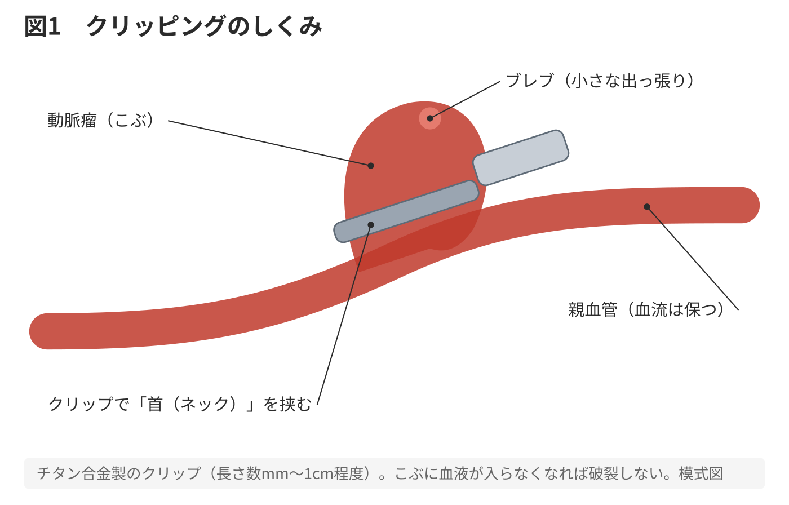

# 第4回 脳動脈瘤クリッピング術

読み方：のうどうみゃくりゅう クリッピングじゅつ

> 2026-11-18の配信版はロードマップ（Claude Docs）の「第4回」タブにあります（図4枚つき）。このページは教材サイト用に要点を整理し直した版です。

## ひとことで言うと

頭蓋骨を開けて顕微鏡で脳のすき間から動脈瘤（血管のこぶ）に近づき、こぶの根元（ネック）を小さな金属のクリップで挟んで、こぶに血液が入らないようにする手術です。破裂（くも膜下出血）を防ぐ、または破れたこぶの再出血を止めるのが目的です。

## どんな時に必要になるか

**病気の成り立ち**

- 脳の動脈の分かれ目の壁が薄くなり、風船のようにふくらんだもの。成人の数%に見つかるとされ、女性にやや多い
- 危険因子：高血圧、喫煙、過度の飲酒、家族歴
- 破裂するとくも膜下出血（SAH）。約1/3が死亡、約1/3に後遺症が残るとされる重い病気

**未破裂（予定手術）**

- 多くは無症状で、脳ドックや頭痛精査のMRA（MRIで血管を見る検査）で偶然見つかる
- 日本の大規模調査（2012年発表）では、5〜6mm以上で年1%程度以上の破裂率。前交通動脈瘤は3〜4mmでも年1%程度、不整形や複数あると高くなる
- 治療を検討する目安（ガイドラインの考え方）：大きさ5〜7mm以上、5mm未満でも症状がある・破れやすい部位（前交通動脈・内頸動脈-後交通動脈分岐部など）・いびつな形やブレブがある・経過観察中に大きくなった
- 年齢・持病・余命・本人の希望を合わせ、「治療のリスク」と「放置のリスク」を比べて決める

**破裂（緊急手術）**

- 突然の激しい頭痛（「バットで殴られたよう」）→ 救急搬送 → CTでくも膜下出血
- 再破裂は発症早期に多いため、できるだけ早く（目安72時間以内）クリップかコイル（第5回）で処置
- 発症4〜14日目は脳血管攣縮（スパズム）の時期

**手術以外の選択肢**

- 経過観察（禁煙・血圧管理）
- コイル塞栓術（カテーテル治療、第5回）
- 使い分けの一般論：クリップは脳の表面に近く入口（ネック）が広い瘤、中大脳動脈瘤、血腫を伴う破裂例が得意。コイルは脳底動脈など深い場所が得意

**手術に至るまで**

- 未破裂：脳ドック／かかりつけ医・内科・頭痛外来でMRA → 脳神経外科紹介 → 3D-CTAや脳血管撮影 → 外来で説明・相談 → 予定入院
- 破裂：救急外来 → 脳神経外科・脳卒中チーム → 当日〜翌日に手術

## 関係する解剖

- 脳の底には、左右の内頸動脈と後ろの椎骨・脳底動脈がつながった「輪」（ウィリス動脈輪）がある
- 動脈瘤は輪とその周りの分かれ目にできやすい：前交通動脈（Acom）、内頸動脈-後交通動脈分岐部（IC-PC）、中大脳動脈分岐部（MCA）が代表
- 脳の底・奥にあるため、前頭葉と側頭葉の間のすき間（シルビウス裂）などを分けて進む
- 周りには視神経・動眼神経・細い穿通枝（脳の深部を養う細い枝）が密集。これを傷つけないことが手術の質を決める

## 麻酔と体位

- 全身麻酔
- あお向けで、頭を反対側へ少し回してピン固定器（メイフィールド）で固定
- 多くは前頭側頭開頭（プテリオナル開頭）。こめかみの上、髪の生え際の内側を弧状に切る（最近は剃毛しない・最小限の施設が多い）
- 運動誘発電位（MEP）などの神経モニタリングを併用することが多い

## 手術の流れ

1. 麻酔、頭部固定、消毒
2. 皮膚切開 → 筋肉をよける → 頭蓋骨に小さな穴を開けてつなぎ、骨を外す（開頭）
3. 硬膜を開け、手術用顕微鏡で脳のすき間を少しずつ分ける
4. 動脈瘤の手前の親血管を確保（万一の破裂に備え、一時的に止められるようにする）
5. 動脈瘤のネックを周りの血管・神経からはがして露出
6. **クリップをかける**。形に合わせて複数本使うことも
7. ICG（インドシアニングリーン）蛍光血管撮影やドップラーで、こぶに血が入らず親血管・枝は流れていることを確認
8. 硬膜を縫う → 骨を戻してチタンプレートで固定 → 皮膚を縫う（皮下ドレーンを置くことが多い）
9. 麻酔から覚まし、意識と手足の動きを確認

## 所要時間・入院期間

- 手術：未破裂でおおむね数時間（麻酔時間を含む。施設・部位で異なる）
- 入院：未破裂で手術日から10日〜2週間程度とする説明が多い
- 破裂（くも膜下出血）：スパズム期を含め数週間〜1か月以上。後遺症があればリハビリ病院へ転院

## 術後の入院生活（未破裂の典型例）

- **当日**：ICUまたは観察室。ベッド上安静、意識・瞳孔・手足の動きを頻回にチェック
- **管**：皮下ドレーンは翌日前後に抜く。尿道カテーテル・動脈ライン・点滴も1〜2日で順次抜去
- **翌日**：CTで出血などを確認 → 座る・立つ・歩くを開始、食事再開、トイレ歩行へ
- **数日〜1週**：シャワー（傷の状態次第）、抜糸または抜鈎は7〜10日目ごろ
- **リハビリ**：問題なければほぼ不要。必要時はPT/OT/STが介入
- **退院**：歩けて、傷がきれいで、画像に問題がなければ退院。術後1か月ごろ外来でCT（慢性硬膜下血腫のチェック）
- 破裂例はICUでスパズム・水頭症の管理が中心で、脳室・脳槽ドレーンが1〜2週入ることもある

## 合併症と副作用

クリッピングもコイルも、脳梗塞などの合併症の確率は現在では数%以下とする専門医の解説がある。ただし数字は動脈瘤の場所・大きさ・施設で大きく変わる。

**術中**

- 術中破裂：こぶが手術中に破れる。頻度は施設・部位で異なる（破裂例で高い）。一時遮断クリップで止血して対応
- 穿通枝・親血管の閉塞 → 脳梗塞：麻痺・言語障害など。ICG撮影やMEPで早めに気づきクリップをかけ直す
- 神経の損傷：動眼神経（まぶたが下がる・物が二重に見える）、視神経（見え方の低下：前床突起近くの瘤）、嗅神経（においが分かりにくい：前交通動脈瘤など）

**術後早期（〜数日）**

- 術後出血（硬膜外・脳内など）：頭痛・意識低下・麻痺。CTで確認し、必要なら再手術
- 脳梗塞・脳のむくみ：麻痺・言葉の障害。点滴治療・リハビリ
- けいれん：頻度は施設により異なる。抗てんかん薬で対応
- 創部感染・髄液漏：傷の赤み・腫れ・発熱・透明な液の漏れ。抗菌薬、まれに骨を外す再手術
- 一時的なまぶたやこめかみの腫れ、あごを開けにくい（側頭筋を切るため）：多くは数週で改善
- 破裂例では別に：脳血管攣縮（発症4〜14日）、水頭症、低ナトリウム血症、肺炎など

**退院後・晩期**

- 慢性硬膜下血腫：術後1〜2か月ごろ、頭痛・ふらつき・物忘れで見つかることがある（第1回の手術で治す）。頻度は報告により異なる
- 額のしわが寄せにくい（顔面神経の枝）、こめかみのへこみ（側頭筋の萎縮）：見た目の問題
- 遅発性のけいれん

**麻酔・薬の副作用**

- 全身麻酔：吐き気・のどの痛み、まれにアレルギー反応、肺炎、深部静脈血栓症
- 抗てんかん薬（レベチラセタムなど）：眠気、ふらつき、イライラ
- ICG（蛍光色素）：まれにアナフィラキシー。ヨウ素を含むためヨード過敏の確認が必要
- 術前・術後の画像（CTA・脳血管撮影）の造影剤：吐き気・発疹、まれにショック、腎機能悪化
- 抗血栓薬を飲んでいる人は、出血を減らすため事前に休薬・調整（主治医と相談）。コイル塞栓術と違い、クリッピング自体のために抗血小板薬を飲む必要は通常ない
- 破裂例でスパズム予防に使う薬（クラゾセンタンなど）：むくみ・肺水腫などの体液貯留に注意

**再発の可能性**

- クリップした場所の再発はきわめて少ないとされる（開頭クリッピングの長所）
- ただし別の場所に新しい動脈瘤ができる、残した他のこぶが大きくなる、などがあるので、長期にMRAでフォロー

**医師の説明でよくある伝え方**

- 「何もしない場合のリスク（年◯%）」と「手術のリスク（◯%）」を並べて、天秤にかけてもらう
- 「一度きちんとクリップがかかれば、根治性（再発しにくさ）が高いのが開頭手術の長所。体への負担と入院の長さが短所」

**看護師が術後に観察するポイント**

- 意識レベル（JCS/GCS）、瞳孔の大きさと左右差、手足の動き・言葉
- 血圧（上がりすぎは出血、下がりすぎは脳梗塞の危険）
- 頭痛・吐き気・けいれんの有無、創部・ドレーン排液の量と色
- 破裂例：スパズム期の新たな麻痺・意識変化、ナトリウム・水分バランス

## 素朴な疑問Q&A

**Q. クリップって何でできているの？外れないの？**
A. 主にチタン合金の、数mm〜1cm程度のバネ式クリップです。一度かけると一生そのまま体内に残し、ふつうは外れません。

**Q. 頭に金属が入っていて、MRIや空港の金属探知機は大丈夫？**
A. 現在のクリップは磁石に引かれない合金製で、MRIを受けられるのが一般的です（病院の患者向け案内にもそう書かれています）。それでも古い年代のクリップの可能性があるため、検査の際は「脳動脈瘤クリップが入っている」と必ず申告します。

**Q. 外した頭の骨はどうなるの？**
A. 手術の最後に元の場所に戻し、小さなチタン製プレートとネジで留めます。数か月かけて周りとくっつきます。穴の部分が少しへこむことはあります。

**Q. こぶはどうなるの？取ってしまうの？**
A. 基本は取らずに、首を挟んで血が入らないようにするだけです。血が入らないこぶはしぼんで、もう破裂しなくなります。

**Q. 髪は全部剃るの？**
A. 昔は広く剃っていましたが、今は剃らない／切開線の周りだけ剃る施設が多く、退院時には傷がほとんど髪で隠れることが多いです。

## 説明と同意のポイント

- **医師**：診断名と動脈瘤の場所・大きさ、放置した場合の破裂リスク、治療法（経過観察・クリッピング・コイル）の比較、合併症とその頻度、輸血の可能性、術中に方針が変わる可能性（クリップが難しい場合のバイパス併用やラッピングなど）
- **看護師**：入院から退院までの流れ（クリニカルパス）、術前の絶食・内服中止（抗血栓薬・糖尿病薬など）、洗髪、術後の安静と観察、家族の待機場所
- **技師**：診療放射線技師は造影検査の副作用と同意、腎機能・アレルギー確認、術後のMRI時のクリップ確認。臨床工学技士は術中モニタリングや顕微鏡・機器の準備
- **医事課**：高額療養費制度（限度額適用認定。マイナ保険証なら事前の申請なしで適用されることが多い）、差額ベッド代、診断書・就労先への書類、未破裂の予防手術でも保険診療であること

## 診療報酬（令和8年）

| 区分 | 名称 | 点数 |
| --- | --- | --- |
| K177「1」 | 脳動脈瘤頸部クリッピング 1箇所 | 114,070点 |
| K177「2」 | 脳動脈瘤頸部クリッピング 2箇所以上 | 128,400点 |
| K177 注1 | ローフローバイパス術併用加算（頭皮の血管を使う吻合） | ＋16,060点 |
| K177 注2 | ハイフローバイパス術併用加算（腕・脚の血管を使う吻合） | ＋30,000点 |

- 「箇所」はクリップの本数や開頭の数ではなく、**クリップが必要な病変の数**で数える
- ローとハイのバイパス加算は1回の手術で併算定できず、主たるもののみ
- 参考：K176 脳動脈瘤流入血管クリッピング（開頭して行うもの）「1」1箇所 82,730点／「2」2箇所以上 108,200点
- クリップ本体は特定保険医療材料「脳動脈瘤手術クリップ」として別に算定

## 現場で使われる言葉

- **アニュリズム**（aneurysm）：動脈瘤
- **UIA**（ユーアイエー）／**未破裂**：unruptured intracranial aneurysm
- **SAH**（エスエーエイチ／サー）：くも膜下出血
- **ネック／ドーム**：こぶの首／こぶの丸い本体
- **ブレブ**（bleb）：こぶ表面の小さな出っ張り。破裂しやすさの目安
- **IC-PC**（アイシーピーシー）：内頸動脈-後交通動脈分岐部動脈瘤
- **Acom**（エーコム）：前交通動脈（瘤）
- **MCA**（エムシーエー）：中大脳動脈
- **プテリオナル**（pterional）：前頭側頭開頭
- **シルビウス裂**：前頭葉と側頭葉の間の溝。ここを分けて進む
- **テンポラリークリップ**（一時遮断クリップ）：親血管を一時的に止める
- **ICG**（アイシージー）：インドシアニングリーン蛍光血管撮影
- **MEP**（エムイーピー）：運動誘発電位。術中の運動機能モニタリング
- **3D-CTA**／**DSA**（ディーエスエー＝脳血管撮影）
- **スパズム**：脳血管攣縮（くも膜下出血後）

## 動画制作で役立つ視点

- 「こぶを取る」ではなく「首を挟む」。最もよくある誤解なので、模式図が有効
- 脳を「切って」入るのではなく、すき間を「分けて」入るイメージで描くと正確
- 顕微鏡で拡大して行う手術。器具や血管のスケール感（クリップは数mm）を比較物で示すと伝わる
- 未破裂と破裂は、緊急度・入院期間・予後がまったく違う。同じ動画で扱うなら明確に分ける
- 「クリップとコイルどちらが優れているか」は動脈瘤ごとに違う。一方を一律に優位と描かない
- 術中写真・動画は刺激が強いため、使う場合は冒頭に注意書き。代わりにイラスト・3D模型で十分伝わる
- 病院の公開動画を引用する場合は、権利と患者の同意（顔・名前が映らないか）を確認

## 参考動画

ロードマップの「第4回」タブに配信時の動画リンクがあります。教材サイトには確認が取れたものだけを載せるため、今回は掲載していません。

## 確認クイズ

1. 脳動脈瘤クリップの主な素材は？（ステンレス／チタン（合金）／プラスチック）
2. 日本のガイドラインで、未破裂脳動脈瘤の治療を検討する大きさの目安は？
3. 1回の手術で、1つの動脈瘤にクリップを3本使った。K177はどれ？（「1」1箇所／「2」2箇所以上）

答え：① チタン（合金）　② 5〜7mm以上（小さくても場所・形・症状で検討）　③「1」1箇所（クリップの本数ではなく病変の数で数える）

## 出典

- [脳動脈瘤頸部クリッピング（K177）（ナレティ、令和8年度）](https://knowlety.jp/ika/k177/)
- [脳動脈瘤流入血管クリッピング（K176）（ナレティ、令和8年度）](https://knowlety.jp/ika/k176/)
- [未破裂脳動脈瘤におけるエビデンスから見る現在の治療選択肢は？（日本医事新報）](https://www.jmedj.co.jp/blogs/product/product_16541)
- [脳動脈瘤の治療選択（メディカルノート）](https://medicalnote.jp/contents/230123-001-IX)
- [未破裂脳動脈瘤に対する開頭クリッピング術（メディカルノート）](https://medicalnote.jp/contents/190626-005-SF)
- [未破裂脳動脈瘤に対する開頭脳動脈瘤クリッピング術（NTT東日本関東病院）](https://www.nmct.ntt-east.co.jp/wp-content/uploads/2026/05/200507_nmct_media_260512.pdf)
- [未破裂脳動脈瘤クリッピングを受けられる方へ（福井赤十字病院）](https://www.fukui-med.jrc.or.jp/wp/wp-content/uploads/37250c7b6a4ccb04c315d2ae63477ec4.pdf)
