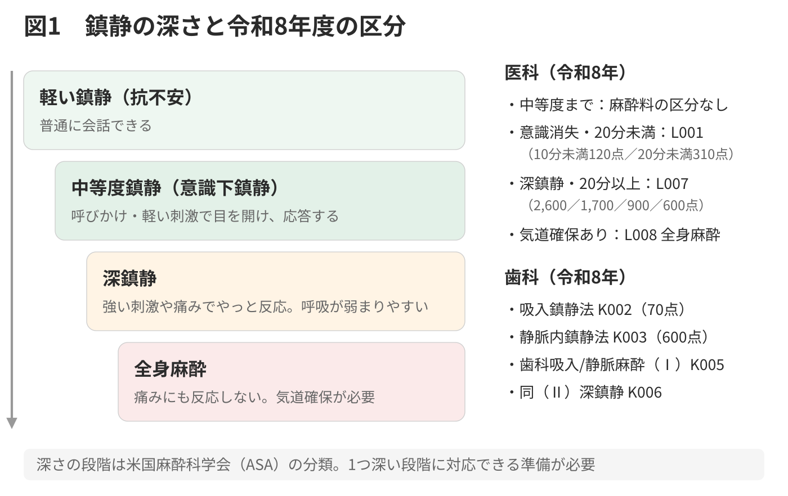
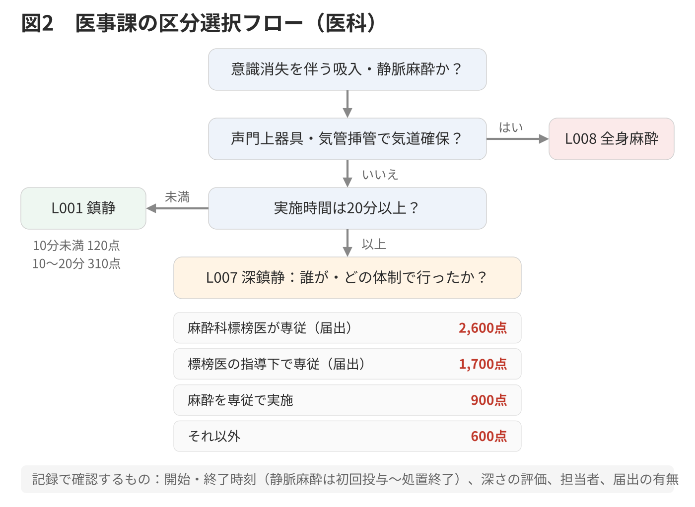

# 特別回 鎮静（ちんせい）と令和8年度診療報酬改定

> この回は、元の配信チャットが読めないため2026-11-20に作り直した版です。11/18のチャットで確認した「歯科麻酔医の説明義務」の内容も反映しています。

## ひとことで言うと

鎮静は、薬で不安や痛みを和らげ、眠ったような状態にして検査や治療を受けやすくすることです。全身麻酔との違いは「深さ」と「気道確保（呼吸の通り道を器具で確保するか）」です。令和8年度（2026年6月施行）の改定で、意識がなくなる鎮静が「時間」と「深さ」と「担当体制」で細かく評価されるようになり、医科と歯科で同じ考え方の区分が新設されました。

## 鎮静の深さ

米国麻酔科学会（ASA）の分類が国内でも使われています。

| 段階 | 患者の状態 | 呼吸・循環 |
| --- | --- | --- |
| 軽い鎮静（抗不安） | 普通に会話できる | 影響なし |
| 中等度鎮静（意識下鎮静） | 呼びかけ・軽い刺激で目を開けて応答する | 通常は保たれる |
| 深鎮静 | 強い刺激や痛みでやっと反応する | 呼吸が弱まりやすく、補助が必要なことがある |
| 全身麻酔 | 痛みにも反応しない | 気道確保・人工呼吸が必要なことが多い |

- 段階はなめらかにつながっていて、薬の量や体質で「思ったより深く」なりやすい
- そのため、狙った段階より1つ深い段階に対応できる準備（人・器具・技術）が必要とされる

## どんな時に使うか

- **検査**：胃・大腸内視鏡、気管支鏡、小児のMRI・CT
- **処置・治療**：内視鏡治療（ESD・ERCP）、カテーテル治療、骨髄穿刺、心臓の除細動
- **歯科**：歯科治療恐怖症、嘔吐反射が強い人、知的障害がある人、配慮が必要な持病がある人、インプラント・親知らずの抜歯など
- **ICU**：人工呼吸器をつけている患者の苦痛を和らげる（集中治療の鎮静は今回の区分とは別）

**誰が担当するか**

- 麻酔科医（麻酔科標榜医）、検査・治療をする各科の医師、歯科医師（歯科麻酔科医を含む）
- 看護師：監視（モニター・呼吸の観察）と記録、回復室での観察
- 安全のため、治療をする人とは別に「監視に専念する人」を置くことが望ましいとされる

## 使う薬

| 薬 | 特徴 | 拮抗薬（効果を打ち消す薬） |
| --- | --- | --- |
| ミダゾラム（ベンゾジアゼピン系） | 不安を和らげ、記憶が残りにくい（健忘） | フルマゼニル |
| プロポフォール | 効き始めも覚めるのも速い。深くなりやすい | なし |
| デクスメデトミジン | 呼吸を抑えにくい。呼びかけで目を覚ましやすい | なし |
| 亜酸化窒素（笑気） | 吸入。歯科の吸入鎮静法で使う | なし（吸入を止めると速く覚める） |
| 鎮痛薬（オピオイド） | 痛みを抑える。併用で呼吸を抑えやすい | ナロキソン |

## 安全管理

- **モニター**：SpO2（血液中の酸素）、血圧、脈拍、必要に応じ心電図・呼気の二酸化炭素（カプノグラフィ）
- **記録**：歯科の考え方（日本歯科医学会）では、静脈内鎮静法・歯科静脈麻酔で5分ごとのバイタル、薬の投与量・時間、有害事象を記録する
- **絶飲食**：深い鎮静・静脈麻酔では全身麻酔に準じ、水などは2時間前まで、牛乳・軽食は6時間前まで、通常の食事は8時間前まで
- **緊急時の体制**：呼吸が止まりそうなときに、器具で気道を確保して全身麻酔に切り替えられる準備
- **帰宅**：付き添い、当日の運転を控えるなど（方法・施設で異なる）

## 合併症と副作用

- **呼吸抑制・低酸素**：最も重要。舌が落ち込んで空気の通り道がふさがる（上気道閉塞）。あごを持ち上げる、酸素、拮抗薬、補助換気
- **低血圧・徐脈**：特にプロポフォール・デクスメデトミジン
- **誤嚥**：胃の内容物が肺に入る。絶飲食で予防
- **覚醒遅延・ふらつき**：転倒に注意
- **せん妄・興奮**：高齢者・小児で起こりやすい
- **アレルギー**：まれ
- **注意が必要な人**：高度肥満、いびき・睡眠時無呼吸症候群、小顎症、扁桃肥大、重い心臓・肺の病気

## 令和8年度改定で何が変わったか

### 医科：麻酔料の再編

| 区分 | 名称 | 点数 | ポイント |
| --- | --- | --- | --- |
| L001（新設） | 吸入麻酔又は静脈麻酔による鎮静 | 「1」10分未満 120点／「2」10分以上20分未満 310点 | 意識消失を伴う吸入麻酔・静脈麻酔。検査・画像診断・処置・手術に伴うもの |
| L007（新設） | 吸入麻酔又は静脈麻酔による深鎮静（声門上器具又は気管挿管による気道確保を伴わないもの） | 「1」2,600点／「2」1,700点／「3」900点／「4」600点 | 20分以上。体制で4区分 |
| L008 | 声門上器具又は気管挿管による気道確保を伴う閉鎖循環式全身麻酔 | （本講では省略） | 気道確保の方法が名称で明確化 |

**L007の4区分**

- 「1」麻酔に従事する医師（麻酔科標榜医）が専従で実施：2,600点（施設基準の届出が必要）
- 「2」麻酔に従事する医師の指導下で麻酔を専従で実施：1,700点（届出が必要）
- 「3」麻酔を専従で実施：900点
- 「4」1〜3以外：600点
- 「1」「2」は2時間を超えると30分ごとに780点・510点の麻酔管理時間加算
- 3歳以上6歳未満の幼児加算（所定点数の10%）がある

**時間の数え方**

- 吸入麻酔：麻酔器をつないだ時から外した時まで
- 静脈麻酔：麻酔剤を最初に投与した時から、検査・処置などが終わった時まで

**施設基準（L007「1」）の例**

- 麻酔管理料（Ⅰ）の届出
- 夜間・休日を含む緊急時の連絡体制と、機器・機材の設置についての手順書を、深鎮静を行う全診療科と麻酔科が協同で作っておく

**小児のマスク麻酔の例外**

- 15歳未満で、麻酔科標榜医が器具による気道確保を不適切と判断し、マスク等で20分以上の全身麻酔を行った場合は、例外的にL008で算定できる。レセプトの摘要欄に医学的な必要性を書く

### 歯科

| 区分 | 名称 | 点数 | ポイント |
| --- | --- | --- | --- |
| K002 | 吸入鎮静法（30分まで） | 70点 | 亜酸化窒素。抗不安〜中等度鎮静の範囲 |
| K003 | 静脈内鎮静法 | 600点 | 意識を消失させない（意識下鎮静）。医科との連携が必要 |
| K005（新設） | 歯科吸入麻酔又は歯科静脈麻酔（Ⅰ） | 10分未満 120点／10分以上20分未満 310点 | 意識消失を伴うもの。医科L001と同じ考え方 |
| K006（新設） | 歯科吸入麻酔又は歯科静脈麻酔（Ⅱ） | 2,600／1,700／900／600点 | 深鎮静。医科L007と同じ考え方 |
| K004 | 歯科麻酔管理料 | 「1」750点／「2」600点 | 「2」はK002・K003・K005・K006を届出歯科医師が行った場合 |

- 吸入鎮静法の実施にあたって参考にする資料として、日本歯科医学会「歯科診療における静脈麻酔等に関する基本的な考え方」（令和8年3月）が示された
- 歯科静脈麻酔（Ⅱ）「1」の歯科麻酔科医：2年以上の経験、全身麻酔200症例以上、静脈内鎮静法または歯科静脈麻酔100症例以上
- 無床の歯科診療所は、病院と連携した緊急時の体制を確保し、受入医療機関名などを届け出る

## 職種ごとの影響

### 医師（麻酔科医／内視鏡・カテーテル・小児検査の担当医）

- **「深さ」と「時間」を記録する意味が大きくなった**：同じ鎮静でも、意識消失の有無、20分を超えたか、気道確保をしたかで区分が変わる。開始・終了時刻と深さの評価をカルテや麻酔記録に残すことが算定の前提になる
- **担当体制で評価が4倍以上違う**：L007「1」2,600点と「4」600点の差は、麻酔科医が専従で関わる価値を評価したもの。考えられる影響として、内視鏡やカテーテル検査に麻酔科が関わる依頼が増える、各科と麻酔科の連携ルールの見直しが進む、などがある
- **安全体制づくり**：緊急時の手順書を全診療科と麻酔科で共同作成することが施設基準になり、院内の取り決めが求められる
- **小児**：マスク麻酔の例外規定やL007の幼児加算など、小児の検査鎮静の評価が明確になった（日本小児麻酔学会は改定内容の解説と、令和10年度改定への要望の募集を行っている）

### 歯科医師（歯科麻酔科医／一般歯科）

- **医科と並ぶ区分**：意識消失を伴う歯科吸入麻酔・歯科静脈麻酔が新設され、医科のL001・L007と同じ枠組みになった
- **深さの管理がより重要に**：静脈内鎮静法は「常に意識を消失させない」状態を保つのが前提。一方、歯科静脈麻酔（深鎮静）は有害事象の頻度・重症度が高まりやすいため、監視を強化する。どちらを行ったかで区分が分かれるため、目標とした深さと実際の状態を記録する
- **治療と麻酔の分担**：日本歯科医学会の考え方では、治療と麻酔を同じ歯科医師が兼ねることは推奨されない
- **医科との連携**：緊急時に備え、事前に医科の保険医療機関と連携しておく
- **説明について**：今回の改定や日本歯科医学会の資料で、患者への説明・同意の新しい要件は確認できなかった（2026-11-18確認）。ただし実務では、意識が残る方法か消失する方法か、絶飲食、リスク、担当者、費用の違いを説明する場面が増えると考えられる

### 医事課

- **区分の選び方**（図2）：意識消失があるか → 器具による気道確保があるか → 20分以上か → 誰がどの体制で行ったか、の順で判断
- **時間の確認**：静脈麻酔は「最初の投与」から「処置の終了」まで。記録の時刻と突き合わせる
- **施設基準**：L007「1」「2」、K006の一部は届出が前提。届出なしで高い区分を請求しないよう、院内で一覧を共有
- **摘要欄**：小児マスク麻酔をL008で算定する場合など、記載が必要なケースを把握
- **査定・返戻のリスク**：記録に深さ・時間・担当者がないと、区分の根拠を示せない。麻酔記録・看護記録との整合を確認
- **レセコンのマスタ更新**：新設コード（L001、L007、K005、K006）の設定と、院内オーダー（医師がどの区分を選ぶか）の整備
- **患者への費用説明**：区分によって点数が大きく違うため、自己負担額の目安も変わる

## 素朴な疑問Q&A

**Q. 鎮静と全身麻酔は何が違う？**
A. 深さと、呼吸の通り道を器具で確保するかどうかです。鎮静は自分で呼吸しているのが前提で、全身麻酔は器具で呼吸を確保することが多いです。

**Q. 鎮静中に話したり夢を見たりするの？**
A. 中等度までの鎮静では呼びかけに応じることができ、会話できることもあります。ミダゾラムなどは記憶が残りにくいため、「眠っていた」と感じることが多いです。

**Q. 記憶がない＝深く眠っていた、ということ？**
A. 必ずしもそうではありません。薬の作用で記憶が残りにくいだけで、実際には呼びかけに応答していることがあります。

**Q. 歯医者で眠ったまま治療できるの？**
A. 静脈内鎮静法は「うとうとしているが呼びかけには応じる」程度を保つ方法です。より深い歯科静脈麻酔や全身麻酔は、体制の整った施設で行います。

**Q. 鎮静のあと車を運転していい？**
A. 静脈内鎮静や深い鎮静のあとは、当日の運転を控えるよう説明されるのが一般的です。笑気の吸入鎮静法では、有害事象がなければ制限が必ずしも必要ないとされています。

## 現場で使われる言葉

- **セデーション**（sedation）：鎮静
- **MAC**（マック）：監視下麻酔管理。麻酔科医が鎮静を管理すること
- **SpO2**（エスピーオーツー）：経皮的酸素飽和度
- **カプノ**：カプノグラフィ（呼気の二酸化炭素モニター）
- **プロポ**：プロポフォール
- **笑気**（しょうき）：亜酸化窒素
- **拮抗**（きっこう）：薬の効果を打ち消すこと
- **ラムゼイスコア**：鎮静の深さを点数で表す指標
- **標榜医**（ひょうぼうい）：厚生労働大臣の許可を受けて「麻酔科」を名乗れる医師

## 動画制作で役立つ視点

- 「眠らせる＝全身麻酔」と混同しない。内視鏡や歯科の鎮静は多くが「浅い〜中等度」
- 「記憶がない＝安全に眠っていた」ではない。呼吸の監視が重要という点を伝えると正確
- 深さは連続していて、意図せず深くなることがある。だから監視役が必要
- 改定は「鎮静を増やす・減らす」ではなく、深さ・時間・体制に応じて評価を分けたもの

## 参考動画

元の回の動画リンクは確認できなかったため、今回は掲載していません。

## 確認クイズ

1. 医科で、意識消失を伴う静脈麻酔を15分行った場合の区分は？
2. L007の4区分で最も高いのは、誰がどう行った場合？
3. 歯科の静脈内鎮静法（K003）は、意識を消失させる方法？

答え：① L001「2」10分以上20分未満 310点　② 麻酔科標榜医が専従で実施（届出あり）2,600点　③ いいえ。意識を消失させない（意識下鎮静）

## 出典

- [L001 吸入麻酔又は静脈麻酔による鎮静（しろぼんねっと、令和8年）](https://shirobon.net/medicalfee/latest/ika/r08_ika/r08i_ch2/r08i2_pa11/r08i2b_sec1/r08i2b1_L001.html)
- [L007 吸入麻酔又は静脈麻酔による深鎮静（ナレティ、令和8年度）](https://knowlety.jp/ika/l007/)
- [深鎮静の施設基準（ナレティ）](https://knowlety.jp/?p=31614)
- [令和8年度診療報酬改定のポイント解説（日本小児麻酔学会）](https://jspedanes.smoosy.atlas.jp/files/12708)
- [令和8年度診療報酬改定 麻酔（ORCA）](https://ftp.orca.med.or.jp/pub/data/receipt/outline/revision/pdf/202606-kaisei-taiou-021100_20260517.pdf)
- [令和8年度診療報酬改定の概要【歯科】（厚生労働省）](https://www.mhlw.go.jp/content/12400000/001671913.pdf)
- [歯科診療における静脈麻酔等に関する基本的な考え方（日本歯科医学会）](https://jads.jp/assets/pdf/basic/r08/document-260326-2.pdf)
- [K002 吸入鎮静法（しろぼんねっと）](https://shirobon.net/medicalfee/latest/shika/r08_shika/r08s_ch2/r08s2_pa10/r08s2a_sec1/r08s2a1_K002.html)
- [K003 静脈内鎮静法（しろぼんねっと）](https://shirobon.net/medicalfee/latest/shika/r08_shika/r08s_ch2/r08s2_pa10/r08s2a_sec1/r08s2a1_K003.html)
- [K004 歯科麻酔管理料（しろぼんねっと）](https://shirobon.net/medicalfee/latest/shika/r08_shika/r08s_ch2/r08s2_pa10/r08s2a_sec1/r08s2a1_K004.html)
- [K005 歯科吸入麻酔又は歯科静脈麻酔(Ⅰ)（しろぼんねっと）](https://shirobon.net/medicalfee/latest/shika/r08_shika/r08s_ch2/r08s2_pa10/r08s2a_sec1/r08s2a1_K005.html)
